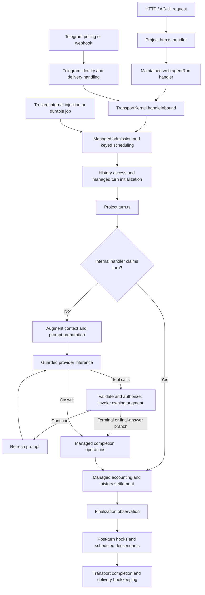

# M6 execution and ownership map

Date: 2026-11-17

Status: The approved follow-up is implemented on `feat/explicit-agent-execution`.
The baseline audit below preserves the pre-change findings. For current behavior,
use the implementation record here and the linked reference application.

The goal is to understand an agent's startup, incoming messages, turns, augments,
and shutdown from its generated project. Auggy continues to maintain the
execution and lifecycle machinery required by an always-on service. Supported
editing boundaries must be explicit; visibility alone does not justify a new
customization API.

## Implementation record

The generated application now executes the assembly sequence directly. These
calls perform the named work; they are not an illustrative copy of a hidden
startup function. The managed runner registers cleanup before any stage begins.

```text
main.ts: prepareConfiguration → createModel → createAugments
         → createAgent({ turnProgram, onTurnFinalized? })
         → transportsFrom / bindTransport → httpBindings → start
http.ts:  selected POST mount → original guarded request delegate
turn.ts:  internal work or prompt → inference → tools → repeat / finish
```

| Supported edit | Executed source | Maintained boundary |
| --- | --- | --- |
| Add startup observations around real stages | [main.ts](../../examples/inspectable-agent/src/main.ts) | Stage ordering, host-owned handles, cleanup and admission remain enforced. |
| Select the turn recipe, lower inference limits, attach an observer | [main.ts](../../examples/inspectable-agent/src/main.ts), [turn.ts](../../examples/inspectable-agent/src/turn.ts) | Guarded operations retain authorization, budgets, cancellation and settlement. |
| Change the literal conversation mount | [http.ts](../../examples/inspectable-agent/src/http.ts) | Authentication, replay and streaming use the existing adapter. Console and endpoint guidance follow the selected mount; the old path is not an alias. |
| Configure capabilities or add domain implementations | `agent.yaml`, project `src/augments/` | YAML is the sole provider/augment graph. Business authorization and lifecycle belong to each augment. |

Fresh scaffolds declare application contract 2. Contract-1 composition remains
supported through the same host stages. The new handles expose safe metadata,
not raw provider clients, secrets or augment instances. The package implementation
remains under `node_modules`; identity and learned-guidance loading are unchanged.

The route collector change is limited to the HTTP boundary: selected mounts and
existing reserved namespaces must reject literal and parameterized augment
collisions before transport registration. No turn-kernel, storage-root, volume,
coordination or deployment architecture change is included.

Review is split across runtime lifecycle, HTTP/authentication, and scaffold/CLI
ownership. The recorded installed-authoring scenarios verified a renamed endpoint and
an actual edit to the then-generated `agent.ts`, including inference count,
observer correlation, authentication, SSE and durable replay. No new test harness or hosted rehearsal
is introduced.

Verification completed on 2026-11-17:

- Product changes: `dd4c1840` (managed assembly), `e30e3954` (HTTP mount),
  `3668e149` (generated project and CLI). Release-fixture corrections: `4706662f`.
- Strict typecheck, repository lint and console build passed. Lint retains the
  pre-existing informational schema-version mismatch.
- Required runtime shards and all 364 console tests completed. The CLI route
  diagnostic assertion was updated and its 20-test file rerun; already passing
  shards were retained, and remaining shards were then completed. Thirteen
  existing disabled-coordination cases remained skipped. The final fixture
  changes passed a further 20 focused tests.
- Packaged installation, console serving, authenticated requests, durable replay,
  dependency checks and foundation upgrade checks passed in `smoke:release`.
  That shell run stopped at historical fixture mismatches. After correcting the
  fixtures, `application-suite.ts` and `authoring-suite.ts` were resumed against
  the same tarballs; the earlier passing release stages were not repeated.
- All 16 installed reference acceptance rows passed, including lifecycle,
  recovery, launcher selection and the existing macOS service checks. Generated
  authoring passed for all four provider selections, inspection, service,
  ownership and deployment-file generation.
- The generated application's actual endpoint and execution-option edits passed
  through direct startup, local run/dev and global run/dev. Authentication, SSE,
  replay before and after restart, inference counts and correlated finalization
  observations were checked. Cleanup was confirmed.

The verified local evidence index and six package artifacts are retained at
`/private/tmp/auggy-m6-verified-p537gsed/verification.json`. These results cover
local installed execution and generated deployment files; they do not claim a
new hosted Railway rehearsal. Contract-2 projects require a contract-2-capable
global CLI when launched globally; historical contract-1 application coverage
uses its matching pinned source.

### Generated entrypoint follow-up

The current scaffold has three execution files: `src/main.ts`, `src/http.ts`
and `src/turn.ts`. `main.ts` exports the named `main`, performs assembly, and
passes `turnProgram` directly to `createAgent`. An optional `onTurnFinalized`
callback belongs at that same call; a separate generated `src/agent.ts` wrapper
is no longer needed. `agent.yaml` declares `./src/main.ts` and remains the sole
enabled-augment graph. Direct start/dev scripts execute that entrypoint.

The baseline sections below retain their historical `index.ts` and `agent.ts`
names. Existing owned applications keep their declared entrypoints until their
engineer changes them; package `src/index.ts` and `src/agent.ts` remain runtime
files and are unaffected by this scaffold naming change. The installed acceptance
record above predates this follow-up.

Follow-up verification on 2026-11-17:

- Focused scaffold, creation, inspection, adoption/recovery and self-authoring
  tests passed (136 tests), alongside the affected release-fixture and builder
  skill checks. Strict typecheck and repository lint passed.
- The installed authoring suite passed against the consolidated scaffold for
  all four provider selections. Direct, local and global launches exercised
  edits to `main.ts`, including an inference limit and finalization observer.
  Inspection, adoption, service lifecycle, owned-file preservation and generated
  deployment-file checks passed; temporary-consumer cleanup was confirmed.
- Evidence: `/private/tmp/auggy-main-authoring.nQ7GFh/authoring-suite.json`.
  Candidate: `/private/tmp/auggy-main-final.4BtS5q/auggy-0.5.0.tgz`.
- The local review demo now opens at `src/main.ts`, passes its generated
  typecheck and recipe tests, and returns a healthy HTTP response. Runtime,
  storage and hosting architecture are unchanged; no hosted rehearsal was run
  for this scaffold consolidation.

## Original baseline and scope

- Implementation baseline: `feat/portable-agent-integration` at
  `c3801001f59749c525385ff24e272a4292c89af5`, the closing M5 candidate. This is
  a branch baseline, not a claim that it has merged into main.
- The existing review project at `/private/tmp/auggy-m6-review` has all four
  generated application files matching this baseline's scaffold templates.
- The [ownership ADR](../adr/2026-11-12-inspectable-agent-application.md)
  establishes the intended application/package boundary. This map distinguishes
  that intention from the narrower interfaces actually implemented.
- M6 here covers inspectability and supported edits. Per the current user scope,
  upgrade certification and an external usability study are not requirements.
  Older milestone references retain their historical wording.
- This is a source audit and design artifact. Existing tests are referenced as
  evidence locations, not represented as newly executed or exhaustive proof.
  M5 hosting/recovery evidence remains separate; this map is not a new enterprise
  readiness certification.

## Ownership rules

1. **Project code owns application decisions.** It selects a turn recipe, binds
   supported HTTP handling, and supplies custom augments. Central YAML remains
   the sole declaration of the provider, enabled augments, and their options.
2. **Package host and transports own process and ingress mechanics.** Runtime
   selection, resource claims, startup admission, identity verification, request
   validation, streaming, delivery tracking, and cleanup remain maintained code.
3. **The package agent and kernel own execution mechanics.** Scheduling,
   authorized tool dispatch, validation, accounting, history settlement,
   cancellation, and outcome-unknown handling are not generated responsibilities.
4. **Augments own capabilities and domain policy.** Built-ins and custom
   implementations use the same contracts. An application's database and durable
   workflows remain its systems of record. Auggy verifies supplied authority and
   enforces declared requirements; domain adapters must still check business
   facts such as order ownership.
5. **Project TypeScript is trusted code.** These contracts are not a sandbox.
   Arbitrary code can block the event loop, ignore cancellation, or acquire
   untracked resources. A timeout is not an isolation boundary. Normal extensions
   must cooperate with lifecycle and cancellation contracts.

The supported deployment remains an independently operated, single-replica
agent using the existing SQLite path. Separate companies deploy separate agents.
This work introduces no shared managed backend, storage-root change, or enabled
PostgreSQL coordination profile.

## Baseline generated project

```text
agent-project/
├── README.md                    Execution guide
├── agent.yaml                   Configuration and enabled capability graph
├── identity.md                  Stable operator-authored prompt guidance
├── learned-behaviors.md          Mutable guidance source, or durable-state seed
├── package.json / bun.lock       Project-selected runtime and dependencies
├── src/
│   ├── index.ts                 Managed host startup
│   ├── agent.ts                 Turn-program and optional observer binding
│   ├── http.ts                  Fixed agent-run mount and guarded delegation
│   ├── turn.ts                  Actual selected inference/tool recipe
│   └── augments/                Engineer-owned capabilities
├── skills/                      Model-visible capability instructions
├── tests/application.test.ts    Generated recipe checks
├── data/                        Local runtime-data convention
└── node_modules/auggy/src/       Installed, readable implementation
    ├── application/             Host, runner and runtime ownership
    ├── agent.ts                 Scheduling and agent lifecycle integration
    ├── kernel/                  Managed turn operations and settlement
    ├── transports/              HTTP ingress, console and stream handling
    └── augments/                Packaged capabilities, including Telegram
```

This is an abbreviated baseline tree. A fresh default project did not contain
every optional augment. A custom augment's files appear when it is created.
There is no automatically loaded project `SOUL.md` or `AGENTS.md` in this
scaffold. Their earlier proposed names must not be presented as delivered.
File naming changes require an explicit purpose/loading decision; this mapping
does not rename files or add duplicate instruction sources.

At baseline, project `src/agent.ts` and installed `auggy/src/agent.ts` were
different files. The former bound execution options; the latter implements the agent. The
package implementation remains inside `node_modules`; it is not copied into
project `src/`.

## Baseline execution paths

### Startup and configuration

| Step | What happens now | Project visibility and package owner |
| --- | --- | --- |
| 1. Select runtime | A direct launch validates its declared entrypoint and project-installed runtime. Compatible CLI launch commands select/delegate to that runtime before executing the application. | `package.json`, lockfile and `agent.yaml`; [runner](../../src/application/runner.ts), [CLI bootstrap](../../src/cli/command-bootstrap.ts), [runtime selection](../../src/cli/project-runtime.ts). |
| 2. Enter application | Direct execution calls `runApplication(main, ...)`; the selected CLI imports the named `main` and calls `runManagedApplication`. The managed runner registers signals before calling `main`. | Historical generated `src/index.ts`; [CLI dev launch](../../src/cli/commands/dev.ts). Top-level imports happen before this managed call. |
| 3. Prepare host | `launch.createHost` registers one host for cleanup. `host.prepare()` parses YAML, checks deployment/storage ownership, resolves the provider and augments, invokes composition, and constructs the hosted agent and optional jobs. | Visible `createHost` / `prepare` calls; implementation in [host](../../src/application/host.ts). The provider and augment graph have been resolved before the project composition callback. |
| 4. Bind recipe | `composeAgent` binds `turnProgram` and may bind `onTurnFinalized`. It receives no provider, augment instances or agent handle through the current public interface. | Historical generated `src/agent.ts`; `ConfiguredAgentComposition` in [types](../../src/types.ts). Calling this explicit project-owned assembly overstates current control. |
| 5. Bind HTTP | `prepared.http.map(configureHttp)` supplies exactly one listener for each configured web transport. There are no HTTP listeners when no web transport is enabled. | [Generated HTTP](../../src/scaffold-templates/application/src/http.ts.template); [managed router](../../src/transports/managed-http-router.ts). Other transports are configured augments. |
| 6. Become ready | The host starts the agent. Augment boot, route validation, transport registration and ready hooks precede admission. Jobs start if configured; the host then opens admission and reports ready. | `host.start(...)`; [host](../../src/application/host.ts), `start` in [package agent](../../src/agent.ts), [lifecycle manager](../../src/kernel/lifecycle-manager.ts). A bound port alone does not establish readiness. |

Resource allocation belongs in the managed lifecycle. The runner does not adopt
arbitrary sockets, timers or database handles created by application imports.
Custom capability resources should use augment construction/lifecycle contracts,
including cleanup on failed construction and `onShutdown` for acquired resources.

### Incoming message to response



The diagram shows ownership and principal branches, not every error or event.
HTTP events can stream during execution. The final-answer branch may make one
additional guarded inference subject to the applicable limits.

| Boundary | Current implementation | What an engineer should understand from the project |
| --- | --- | --- |
| HTTP ingress | The router dispatches `POST /agent/run` into the project wrapper. `web.agentRun` consumes the original managed request once and delegates to `handleAgentRun` in [web transport](../../src/transports/web-transport.ts). | The wrapper is the mount/delegation point. It is not the implementation of authentication or the turn loop. |
| Identity and delivery | Web transport verifies configured credentials/assertions, validates the input, determines peer/authorization context, and handles applicable replay/history rules before calling `k.handleInbound`. | Application permissions originate in the application's verified authority. Neither a body field nor prompt text establishes trust. Idempotency depends on the applicable request and transport configuration; it is not universal exactly-once delivery. |
| Other channels | [Telegram](../../src/augments/telegramTransport/index.ts) handles its own identity, inbound validation and delivery/replay behavior before `kernel.handleInbound`. Trusted internal injection uses the package agent's `inject`. | AG-UI is the HTTP conversation protocol. Telegram does not call the project's HTTP conversation route. Both enter the same managed execution system. A future transport must implement the transport contract. |
| Scheduling and history | `scheduleTurn` and `executeThreadTurn` in [package agent](../../src/agent.ts) enforce admission, source/thread bounds, authorized history access and settlement. [Keyed scheduler](../../src/kernel/keyed-turn-scheduler.ts) owns work occupancy. | The project's recipe begins after managed initialization. Transport requests and trusted injections do not bypass scheduling by calling the recipe directly. |
| Context and inference | `executeManagedTurn` in [turn session](../../src/kernel/turn-session.ts) initializes admission/hooks and invokes the selected project recipe. `preparePrompt` collects context and tools; `infer` uses the configured provider. | `turn.ts` is executed, not a demonstration copy. Context contributions come from augments; the loop does not grant itself new authority or directly call a raw provider. |
| Tools and augments | `executeTools` checks capability requirements, schemas, delegated authorization and reservations before invoking the owning tool implementation. See [turn session](../../src/kernel/turn-session.ts) and [capability table](../../src/kernel/capability-table.ts). | Follow the capability's YAML declaration to a custom module or packaged built-in. Domain logic stays in that augment. The managed operation retains execution bookkeeping. |
| Internal turns | `dispatchInternalTurn` can select an augment's `handleInternalTurn` before model inference. The managed settlement path still applies. | Not every turn calls a model. Background memory work and other internal handlers need to be shown as a real branch. |
| Completion and follow-up | Kernel settlement and authorized history commit precede the normal `onTurnFinalized` observation. `runPostTurn` then runs hooks and scheduled descendants; the transport handles its own completion/delivery state. | A returned completion receipt is not permission to release runtime resources. The observer's declared boundary is `before-post-turn`, not “all work and delivery finished.” |

Two timing distinctions must appear in project-facing explanations:

- `await web.agentRun(request)` returns a `Response` whose body may still be
  streaming. Measuring that await does not measure the whole turn. The package
  tracks continuing work for lifecycle ownership.
- `onTurnFinalized` supplies bounded metadata, not raw prompt/tool payloads.
  Observer errors are swallowed and asynchronous waiting is bounded to one second
  by [turn observation](../../src/kernel/turn-observation.ts). It is an observation
  point, not a required business-effect hook or proof of transport delivery.

### Shutdown and failures

`SIGINT` / `SIGTERM` reaches the package runner, which calls the owned host's
`stop` with the managed deadline (currently 15 seconds). The host closes
admission, joins preparation/in-flight work, and stops jobs and augments through
its cleanup path. Runtime claims are released only when closure is established.
An expired deadline or uncertain cleanup can retain ownership and produce an
unsuccessful exit; the project must not manufacture a successful shutdown.

The same host cleanup path covers preparation and startup failures. The public
`host.stop({ deadlineMs })` exists, but normal project startup does not need to
reimplement process signal handling. See [runner](../../src/application/runner.ts),
[host](../../src/application/host.ts), [runtime ownership](../../src/application/runtime-ownership.ts),
and `stop` in [package agent](../../src/agent.ts).

This is an availability boundary as well as a safety boundary: a timeout must
not be described as proof that an external effect stopped. Active/uncertain work
can retain lanes or claims. Production supervision/restart remains an operator
and deployment concern; the mapping introduces no new watchdog or retry policy.

## Baseline editing envelope

“Supported” means using the public contract while retaining its guarantees.
Editing framework source is possible, but is framework maintenance rather than
a supported project customization. This table records today's behavior; it does
not grant new APIs or remove existing public APIs.

| Engineering edit | Current supported location | Boundary and current limitation |
| --- | --- | --- |
| Select provider, model, settings, enabled augments | `agent.yaml` | Validated configuration is authoritative. No competing augment/provider list in project TypeScript. |
| Change stable identity or instructions | `identity.md`, selected by YAML | The shorthand expands to immutable, operator-origin, required system context through fileMemory. Engineer-authored instructions are not runtime authentication or authorization rules. See [parser](../../src/cli/config-parser.ts). |
| Change learned guidance | Configured fileMemory capability | Default learned-behavior writes require creator trust. With an admitted runtime root, the project file is the initial seed and the active copy lives under that root; editing the seed does not replace existing durable state. See [resolver](../../src/cli/augment-resolver.ts), [fileMemory](../../src/augments/fileMemory/index.ts), [storage guide](../16-storage-layout.md). |
| Teach capability use | Project `skills/` | Model-visible instructions. They do not grant tool/route authority or replace deterministic checks. |
| Add domain tools, context, routes, memory or a transport | A custom augment declared in YAML | Use the existing augment contracts, schemas, explicit authorization and lifecycle. Additional business HTTP routes belong here. |
| Wrap startup with application code | `src/index.ts` | Preserve one managed host and its prepare/start sequence. Use augment lifecycle for capability resources; arbitrary imports/resources are not automatically managed. |
| Select the turn program or finalization observer | `src/agent.ts` | Supported, but this is currently a binding callback. It cannot inspect or replace the resolved provider/augment graph through `ConfiguredAgentComposition`. |
| Observe/delegate an incoming run request | `src/http.ts` | Available request metadata is read-only. Delegate the original receipt once; the API does not expose a raw editable request body. Streaming completion has separate ownership. |
| Rename the conversation endpoint | Proposed HTTP control | Unsupported today: the literal type, dispatch checks, console proxy and other consumers fix `/agent/run`. Do not imply that changing the generated string works. |
| Lower inference allowance or set a bounded recipe deadline | `src/turn.ts` binding | `maxInferences` must be positive and at most the configured limit. `timeoutMs` is bounded to 900,000 ms. Existing managed validation applies. |
| Branch or stop at an allowed turn phase | `src/turn.ts` | Operations enforce phase and receipt ownership. `stop("application-limit")` is a limit completion, not an arbitrary successful handoff response. No arbitrary reordering or concurrent phase calls. |
| Branch on a specific tool's business outcome | No adequate current turn observation | Tool receipts expose a count, not tool names/results. A new observation/control API is deferred until a concrete requirement justifies it. Existing domain behavior can use augment contracts. |
| Add telemetry | Existing finalization observer or appropriate augment hook | Respect the named observation boundary and payload scope. Observers are not durable business workflows; arbitrary inline logging may delay or fail application code. |
| Change a packaged capability's behavior | Its supported options, or an explicit custom augment implementation | Keep changes owned by the project behind the augment contract. Direct dependency edits are not the normal extension path. |
| Change scheduling, settlement, leases or shutdown mechanics | Maintained package implementation | Public configuration may tune documented limits. Reimplementing these mechanics in generated files is outside this editing envelope. |

The detailed contracts are [ManagedTurnSession, AgentComposer and HTTP types](../../src/types.ts).
Raw provider/tool calls from arbitrary TypeScript bypass the managed execution
contract; exposing source does not make those calls equivalent to managed work.

## Original gaps and recommended disposition

| Finding | Kind | Narrow next step |
| --- | --- | --- |
| Startup and shutdown look asymmetric: startup is visible, signal/drain ownership is implicit. | Inspectability | Explain the managed runner's lifetime and failure path next to the real startup calls and in the project guide. Keep cleanup implementation maintained. |
| `composeAgent` is described more broadly than its binding-only API warrants. | Inspectability | Explain the resolved YAML/provider/augment handoff and name the callback's actual role. Do not create additional factory knobs merely to enlarge the file. Review whether the resulting project is understandable before proposing an API change. |
| The HTTP-to-scheduler-to-recipe handoff is hidden behind `web.agentRun`. | Inspectability | Include the concrete trace and ownership labels in the generated guide, including Telegram and internal-turn branches. Reuse the existing source index for deeper implementation navigation. |
| Generated HTTP source appears to offer an editable path but rejects changes. | Editing contract | Candidate for one focused transport change, specified below; not required to make the current execution path understandable. |
| The recipe is real, but “edit orchestration” overstates freedom to reorder phases or inspect outcomes. | Inspectability and contract wording | Document the supported limits, branches and receipt rules with one actual permitted edit. Defer new turn observations/control until a business use case warrants them. |
| Prompt identity, mutable guidance and active durable state can be confused. | Ownership | Explain their loading, write authority and seed/state distinction using existing behavior. No rename, storage relocation or new memory mechanism. |

Generated documentation should explain the normal path without requiring
`node_modules` exploration. Links into the installed source remain available
for implementation-level debugging. [Passive inspection](../../src/cli/authoring/inspection.ts)
and the [source index](../../src/cli/authoring/inspection-index.ts) already provide
navigation; they do not execute the application, prove readiness, or infer an
arbitrary TypeScript call graph. No new inspection daemon or generated runtime
copy is needed for this work.

## Original endpoint-rename proposal

Proposed use case: change only the HTTP mount from `POST /agent/run` to
`POST /support/chat` in project `http.ts`. This is not implemented by this map.

| Contract question | Proposed answer |
| --- | --- |
| Authority | One registered mount descriptor in project HTTP wiring. Keep `/agent/run` as the default. No second path setting in YAML. |
| Preserved semantics | Same `POST` request/response protocol, identity, authorization, idempotency, history, limits, streaming and lifecycle ownership. |
| Propagation | Dispatch and console proxy use the selected descriptor; runtime info/integration guidance must agree. Static inspection must report unresolved application-owned values honestly rather than execute project code to discover them. External callers must use the selected URL. |
| Validation | Reject invalid paths and ambiguous/reserved route collisions before opening admission, including conflicts with custom augment routes. Preserve the existing reserved-route protections. |
| Old path | No implicit alias or fallback exposing the old run endpoint. Explicit alias support is outside this first change. |
| Activation | Select at startup. No live route mutation. Non-HTTP channels continue using their existing ingress. |
| Failure behavior | Invalid registration fails startup under the existing cleanup path. Runtime handler errors retain existing managed failure behavior. |

Affected implementation includes the public HTTP types, managed router, web
transport, console proxy, route collision validation and endpoint guidance.
The current [route collector](../../src/kernel/route-collector.ts) also reserves
`/agent/run` and the `/agent/` namespace. Supporting a different path needs
consistent collision validation; changing the TypeScript literal alone is
insufficient. If validation requires a change in this kernel-adjacent collector,
the implementation plan must identify that boundary reason explicitly. No turn
execution redesign is implied.

Acceptance should use an installed CLI-generated project edited to the new path:
successful streaming through the new endpoint, the old endpoint unavailable,
the same authentication/authorization failures, unchanged applicable replay
behavior, a working console, consistent endpoint guidance, and startup rejection
of collisions. Include OPTIONS/CORS and applicable route-policy interactions in
focused transport checks. Reuse existing fixtures; a path change alone does not
justify another hosted Railway rehearsal.

## Original follow-up order and mapping verification

1. **Review this map against the generated project.** The owner should be able
   to locate startup, ingress, recipe, custom capability, state and shutdown
   ownership. Record an unclear handoff as a visibility gap, not automatically
   as a request for a new API.
2. **Align project-facing explanations and examples.** Make maintained
   boundaries explicit and describe the actual editable contract. Keep examples
   on the code path that executes; do not add decorative wrappers or a second
   demonstration loop. No existing code is changed by this mapping task.
3. **Plan the endpoint control separately if selected.** Review the complete
   propagation/validation scope above before implementation. This is the first
   concrete editing candidate, not a prerequisite for inspectability.
4. **Reassess remaining controls from real use cases.** Broad request mutation,
   arbitrary turn phases, raw tool execution and additional lifecycle APIs are
   not part of this scope. Do not expand or remove APIs just to simplify the map.

Existing verification locations for future changes:

| Boundary changed | Reuse this evidence/test surface |
| --- | --- |
| Generated files and descriptions | [Scaffold tests](../../tests/cli/scaffold-application.test.ts), generated project source/typechecking, and the existing installed-authoring checks. |
| HTTP mount/delegation | [Managed router](../../tests/transports/managed-http-router.test.ts), [managed web transport](../../tests/transports/managed-web-transport.test.ts), relevant console tests, and [delegated authorization integration](../../tests/integration/delegated-authz-agent-run.test.ts). |
| Host/lifecycle | [Host](../../tests/application/host.test.ts), [runner](../../tests/application/runner.test.ts), [hosted agent](../../tests/application/hosted-agent.test.ts) and [resolver rollback](../../tests/application/resolver-rollback.test.ts). |
| Turn control or observation | [Turn program](../../tests/kernel/turn-program.test.ts), [turn observation](../../tests/kernel/turn-observation.test.ts), and [scheduler](../../tests/kernel/keyed-turn-scheduler.test.ts). |
| Identity or file memory semantics | [Identity shorthand](../../tests/cli/identity-shorthand.test.ts) and [file memory](../../tests/augments/file-memory.test.ts). No semantic change is proposed here. |

For this documentation-only mapping, verify source references, generated-template
agreement, diff scope, and required repository lint. Runtime tests, model calls,
deployment resources and a new harness are unnecessary. Future implementation
must run focused tests for the affected contracts and the repository's required
checks; existing M5 evidence must not be treated as proof of subsequently changed
behavior.

Mapping verification completed: all four review-project application files match
the scaffold templates, all 47 local Markdown references resolve, and whitespace
checks pass. `bun run lint` exited successfully (801 files; existing informational
schema mismatch between the 2.5.0 configuration URL and 2.5.5 CLI). No fixes were
applied by lint. Runtime suites, model calls and hosted rehearsals were not run
for this documentation change.
